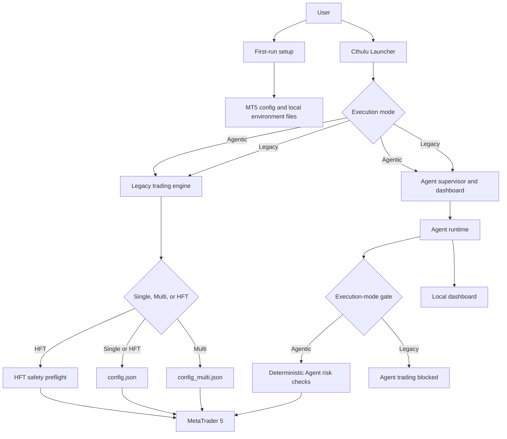

# Cthulu System Overview

This page describes the current Windows runtime at a high level. For installation and operator steps, see the [Quick Start](docs/02_QUICKSTART.md) and [root README](readme.md). This overview replaces older version-specific CLI, performance, and test-count claims.

## Runtime shape

In **Agentic** mode, the Legacy trading engine and Agent runtime run in parallel and have separate risk checks. In **Legacy** mode, the Legacy engine remains the active trader; the dashboard runtime starts, but the Agent is prevented from placing or managing trades. The Agent receives selected Legacy signal/context information through the shared local data bridge.

The Agent supervisor restarts the Agent process with backoff after an unexpected exit. It does not restart the Legacy engine.

## Mode and configuration reference

| Choice | Configuration / behavior |
|---|---|
| **Single** | `config.json` |
| **Multi** | `config_multi.json`; the launcher uses the configured ultra-aggressive Legacy mindset |
| **HFT** | `config.json`, M1 data, broker-universe scanning, and HFT preflight |

HFT is selected after the execution mode; it is not a third execution owner. Its current preflight requires a real MT5 account with trading enabled, tradable symbols, stop protection for existing positions/orders, at most 10 active orders, and aggregate stop risk at or below 5%. Demo accounts do not pass this preflight. The HFT Agent profile has ceilings of 1% risk per entry, 5% aggregate open risk, and 10 active orders. Configured loss and drawdown halts remain in effect.

## Setup and safety

The Windows first-run wizard writes the MT5, risk, and optional Cloudflare AI Gateway settings but does not start the trading system. The default risk inputs are 0.5% maximum risk per trade, 2% daily-loss stop, 10% drawdown halt, and 3 simultaneous positions.

The wizard sets `LIVE_RUN_CONFIRM=1`; the Agent autonomy default is `autonomous`. Agentic startup can therefore place orders on the configured real account without a per-order confirmation. Test Single/Multi on a demo account and review the Agent autonomy setting before any live use.

The dashboard offers **Kill and stay down** and **Restart services**. The kill switch stops Cthulu services and persists until the user explicitly resumes through the launcher. It does not close broker positions, cancel pending orders, or erase logs, databases, or trading history.

## Local data

- `config.json` and `config_multi.json` hold Legacy trading configuration.
- `.env` and `cthulu_agent\.env.agent` hold local settings and secrets; they are ACL-restricted on Windows but not encrypted. Never commit or share them.
- `data\agent.db` stores Agent journal/runtime state.
- `logs\` contains setup, startup, engine, Agent, supervisor, and HFT preflight output.

For exact setup commands, log names, dashboard access, and troubleshooting, use the [Quick Start](docs/02_QUICKSTART.md).
